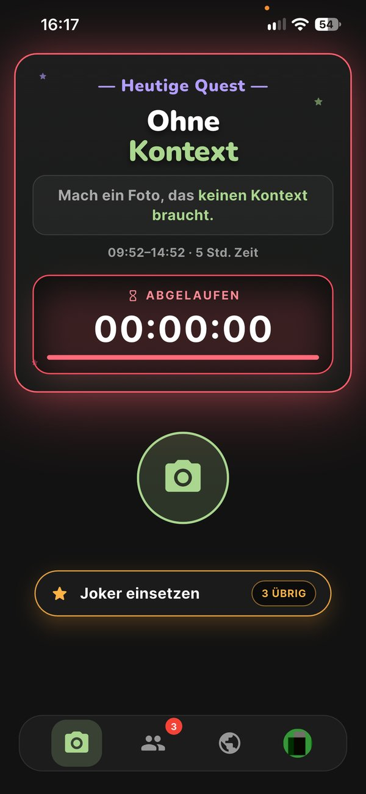
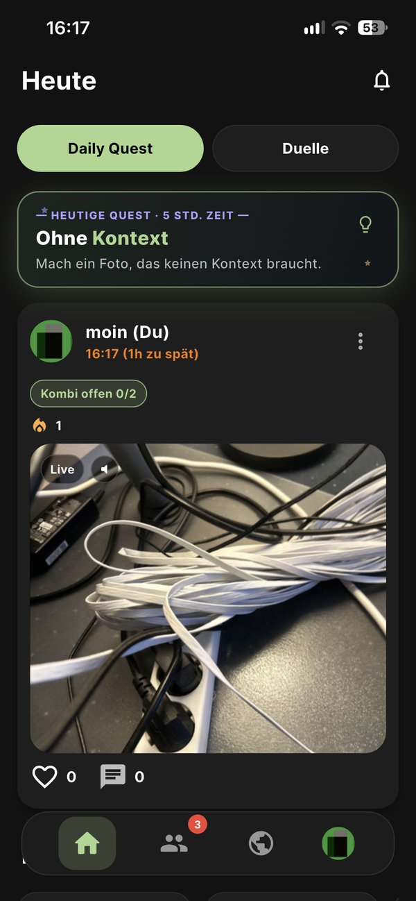
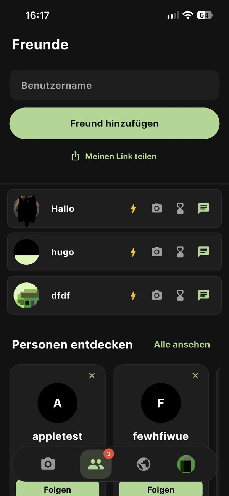
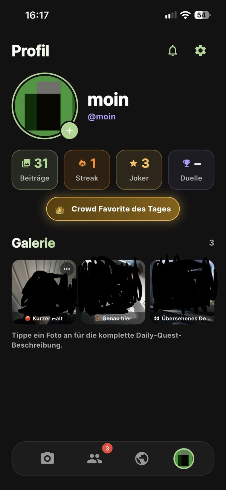

# SideQuest 📸

> *A daily photo quest you play with your friends*

Jeden Tag bekommen alle **dieselbe Foto-Aufgabe**, zu einer **zufälligen Uhrzeit**. Du hast 2 bis 5 Stunden, um dein Foto oder Live Photo zu posten. Danach siehst du, was deine Freunde daraus gemacht haben, und stimmst ab. Dazu kommen 1-gegen-1-Duelle, Streaks und ein täglicher „Crowd Favorite“.

**Status:** Beta in Vorbereitung (TestFlight / Google Play Closed Test).

<table>
  <tr>
    <td align="center"><br><sub>Daily Quest</sub></td>
    <td align="center"><br><sub>Feed</sub></td>
    <td align="center"><br><sub>Freunde & Duelle</sub></td>
    <td align="center"><br><sub>Profil</sub></td>
  </tr>
</table>

---

## Was die App kann

| Bereich | Funktionen |
|---|---|
| **Daily Quest** | Eine Quest pro Tag für alle, aus einem Katalog von über 100 Aufgaben. Pro Datum fest geplant. Start zufällig zwischen 9 und 19 Uhr (London), Laufzeit 2 oder 5 Stunden. Fotos oder **Live Photos** (natives Capture auf iOS und Android). |
| **Feed & Rangliste** | Feed der Freunde, öffentliche Rangliste nach Likes. Die Rangliste ist erst sichtbar, wenn du selbst gepostet hast. Dazu Kommentare mit @-Erwähnungen und Collab-Posts. |
| **Duelle** | Freunde herausfordern, ein Glücksrad lost die Aufgabe aus, beide haben 30 Minuten. Danach stimmen alle bis zur nächsten Quest ab, und der Server ermittelt den Sieger. |
| **Belohnungen** | Streaks. Ein Joker rettet automatisch einen verpassten Tag. Der „Crowd Favorite“ des Tages bekommt +3 Joker. |
| **Freunde finden** | Einladungslink mit Benutzername, Kontaktabgleich über SHA-256-Hashes auf dem Server, Vorschläge über gemeinsame Freunde. |
| **Kommunikation** | Chat mit Zugestellt- und Gelesen-Häkchen, Reaktionen, Mitteilungszentrale, Push-Benachrichtigungen auf Deutsch und Englisch. |
| **Sicherheit & Store** | Melden und Blockieren, Moderations-Queue, vollständige Kontolöschung, Rate-Limits, Einwilligung für Analytics. |

## Technik

- **App:** Flutter 3.47 (Dart), etwa 40.000 Zeilen in `lib/`. Eine Codebasis für iOS und Android.
- **Backend:** Supabase.
  - **Postgres mit Row Level Security** auf allen Tabellen.
  - **39 Migrationen** in `supabase/migrations/`.
  - Die Spielregeln laufen über Trigger und RPCs **auf dem Server**: Serverzeit, Streaks, Duell-Auswertung, Ranglisten-Berechnung, Schutz gegen Manipulation durch den Client.
  - `pg_cron` für tägliche Jobs (Quest-Plan, Auswertungen, Erinnerungen), `pg_net` für Push-Events.
  - Geheimnisse liegen im Supabase Vault.
- **Edge Functions** (Deno/TypeScript) in `supabase/functions/`:
  - `notify-event`: alle Event-Pushes, mit Sperr-Filter, Einstellungen und Sprache.
  - `send-push`: FCM HTTP v1.
  - `daily-scheduler`: Quest-Start, Erinnerungen, Crowd Favorite.
  - `delete-account` und `invite`.
- **Nativ:**
  - Swift (AVFoundation): Live-Photo-Aufnahme und Clip-Kompression auf etwa 1/10 der Größe.
  - Kotlin (CameraX): Aufnahme mit begrenzter Bitrate.
- **Medien:** Kleine Vorschaubilder für Raster-Ansichten, ein Festplatten-Cache für Bilder und Clips sowie signierte URLs für private Dateien.
- **Qualität:**
  - 80+ Unit- und Widget-Tests (`flutter test`), `flutter analyze` ohne Befunde.
  - GitHub Actions für Analyse und Tests, Codemagic für iOS-Builds.

## Projektstruktur

```
lib/
  main.dart, friends.dart, global.dart, profile.dart   Haupt-Screens (Quest/Feed, Freunde, Rangliste, Profil)
  features/                                            Duelle, Daily Quest, Einladungen, Live Photo, Medien, Moderation, …
  core/                                                Umgebung, Logging, Fehlertexte, signierte Medien
  widgets/                                             wiederverwendbare UI-Bausteine
ios/Runner/LivePhoto*.swift, android/…/livephoto/      native Live-Photo-Kamera
supabase/
  migrations/                                          Datenbank-Schema, RLS, Trigger, RPCs, Cron-Jobs
  functions/                                           Edge Functions (Deno/TypeScript)
test/                                                  Unit- und Widget-Tests
docs/                                                  Rechtstexte (Entwürfe), Release-Checkliste
```

## Lokal starten

1. Flutter 3.47 und die Plattform-SDKs installieren.
2. Ausführen:
   ```
   flutter pub get
   flutter analyze
   flutter test
   ```
3. **Für einen echten Build:**
   - Die Firebase-Konfiguration `ios/Runner/GoogleService-Info.plist` bzw. `android/app/google-services.json` aus der Firebase-Konsole ergänzen. Sie ist hier bewusst nicht eingecheckt.
   - Android-Signatur: `android/key.properties.example` nach `android/key.properties` kopieren.
   - Die Laufzeit-Werte stehen in `lib/core/app_environment.dart` und lassen sich per `--dart-define` überschreiben.
   - Der eingetragene Supabase-Schlüssel ist der öffentliche Anon-Key. Die Daten schützt RLS.

---

*Dieses Repository ist ein Schnappschuss des Projekts (Stand 25.10.2026). Die Entwicklung läuft in einem privaten Repository.*
